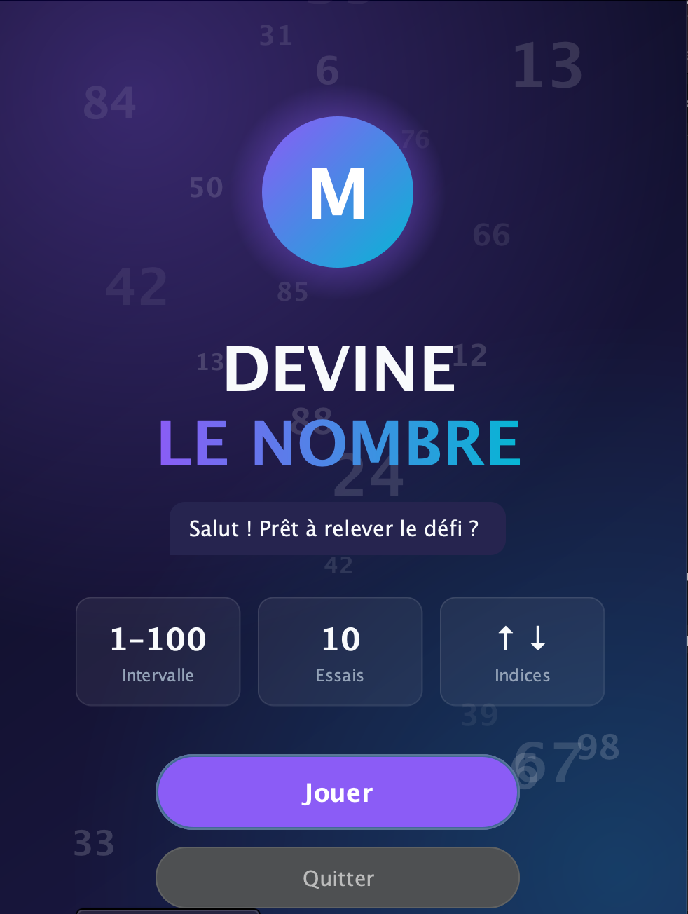
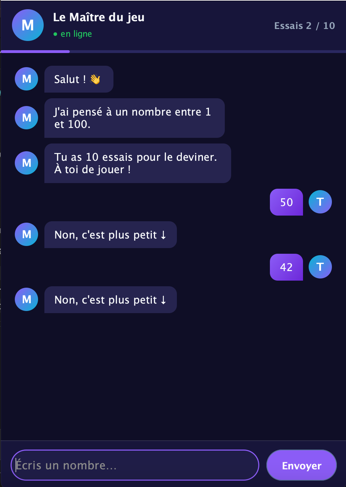

#Jeux Devine 

Jeu de devinette en **Java Swing** présenté comme une conversation : le Maître du jeu choisit un nombre entre 1 et 100, et tu as 10 essais pour le trouver grâce à ses indices.

## Prérequis

- Java 17 ou plus
- [FlatLaf 3.5.4](https://repo1.maven.org/maven2/com/formdev/flatlaf/3.5.4/flatlaf-3.5.4.jar) (un seul `.jar`)
## Aperçu

| Accueil | Partie |
|---|---|
|  |  |
  
## Lancer le jeu

**Eclipse :** ajoute le `.jar` via *Build Path → Configure Build Path → Libraries → Add JARs…*, puis *Run As → Java Application* sur `JeuDevineGUI.java`.

**Terminal :**

```bash
javac -encoding UTF-8 -cp flatlaf-3.5.4.jar *.java
java -cp ".:flatlaf-3.5.4.jar" JeuDevineGUI    # Windows : remplace ":" par ";"
```

## Structure

| Fichier | Rôle |
|---|---|
| `GameLogic` | Logique du jeu |
| `Dialogue` | Phrases du Maître |
| `Theme` | Couleurs et style |
| `Composants` | Bulles, avatars |
| `PageAccueil` | Page d'accueil |
| `JeuDevineGUI` | Fenêtre principale |

